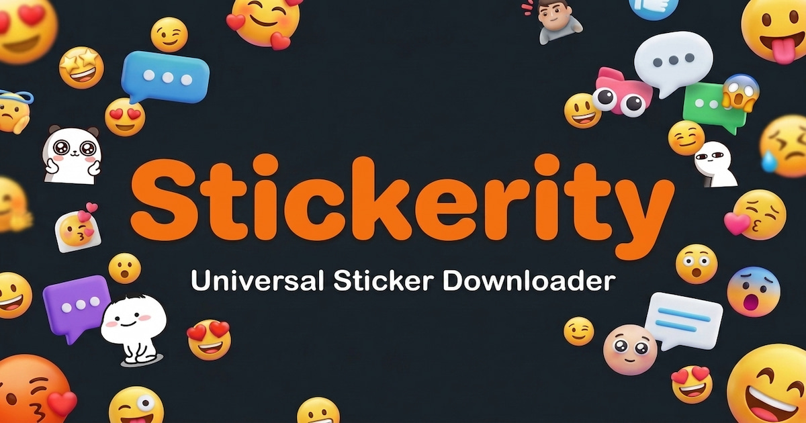
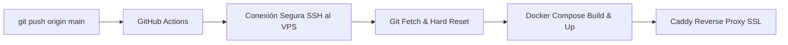

<div align="center">

# 🚀 Stickerity

**Herramienta web full-stack de alto rendimiento para extraer stickers e imágenes de redes sociales y convertirlos a formatos optimizados para WhatsApp.**

[](https://stickerity.app)
[](./LICENSE)
[](https://www.typescriptlang.org/)
[](https://react.dev/)
[](https://fastify.dev/)
[](https://playwright.dev/)
[](https://www.docker.com/)

<br />



</div>

---

## 📖 Descripción General

**Stickerity** es una aplicación web integral (Monorepo) diseñada para resolver un problema común entre usuarios de mensajería instantánea: la dificultad para extraer, convertir y conservar stickers y GIFs de redes sociales (como comentarios y publicaciones de TikTok) para su uso en WhatsApp.

La plataforma implementa un pipeline automatizado que localiza recursos multimedia dinámicos, los procesa al vuelo y los entrega cumpliendo con los estándares estrictos de WhatsApp (**WebP animado, 512x512 píxeles, canal alfa y peso menor a 500 KB**), ya sea en descarga individual o en paquetes `.ZIP`.

---

## ✨ Características Principales

* **Extracción Inteligente:** Rastreo y captura de stickers animados (`.awebp`), GIFs y gráficos en comentarios mediante automatización headless con evasión de bloqueos.
* **Procesamiento y Transcodificación al Vuelo:** Redimensionamiento y compresión adaptativa a formato WebP cumpliendo el límite estricto de < 500 KB y resolución exacta de 512x512 para WhatsApp.
* **Descarga Individual y en Lote:** Empaquetado dinámico en memoria de múltiples archivos en formato `.ZIP` sin almacenamiento persistente.
* **SPA Reactiva y Moderna:** Interfaz con diseño *Glassmorphism*, modo oscuro nativo, microinteracciones fluidas y notificaciones interactivas.
* **Internacionalización Completa (i18n):** Soporte bilingüe dinámico (Español / Inglés) con detección automática de idioma del navegador.
* **Arquitectura Resiliente y Segura:** Contenedores Docker configurados bajo el principio de menor privilegio (`read_only`, usuario no-root, límites de CPU/RAM).

---

## 🛠️ Tecnologías y Arquitectura

El proyecto está estructurado como un **Monorepo** con separación limpia entre la capa de interfaz y los servicios de backend:

```
Stickerity/
├── frontend/             # Single Page Application (React 19 + Vite)
│   ├── src/
│   │   ├── components/   # Componentes modulares (StickerCard, DownloadPopover, etc.)
│   │   ├── locales/      # Archivos de traducción i18n (es/en)
│   │   ├── pages/        # Vistas de contenido legal y documentación
│   │   └── App.tsx       # Lógica principal de UI y estado
│   └── nginx.conf        # Servidor estático optimizado para producción
├── backend/              # API REST de alto rendimiento (Fastify + TypeScript)
│   ├── src/
│   │   ├── routes/       # Endpoints de extracción y proxy de recursos
│   │   ├── services/     # Motor de scraping (Playwright), caché (LRU) y transcodificación
│   │   └── server.ts     # Configuración y arranque de Fastify
│   └── Dockerfile        # Imagen multi-stage con Chromium y FFmpeg
├── .github/workflows/    # Pipeline CI/CD automatizado hacia VPS
└── docker-compose.yml    # Orquestación de servicios en producción
```

### Stack Técnico

| Capa | Tecnologías | Propósito |
| :--- | :--- | :--- |
| **Frontend** | React 19, TypeScript, Vite, Tailwind CSS | Interfaz de usuario SPA ultrarrápida y tipado estático |
| **Internacionalización** | `i18next`, `react-i18next` | Soporte multi-idioma sin recargas de página |
| **Backend API** | Node.js (v20+), Fastify, TypeScript | API REST asíncrona de alto rendimiento y bajo consumo |
| **Web Scraping** | Microsoft Playwright, `puppeteer-extra-plugin-stealth` | Renderizado headless, bypass de detección y scroll dinámico |
| **Procesamiento Multimedia** | `sharp`, `fluent-ffmpeg`, `node-webpmux` | Transcodificación de video/animación y optimización WebP |
| **Caché en Memoria** | `lru-cache` | Reducción de latencia en peticiones idénticas repetidas |
| **Infraestructura** | Docker Compose, Nginx, Caddy Server | Despliegue en contenedores con HTTPS automático |
| **CI/CD** | GitHub Actions | Despliegue continuo automatizado en VPS vía SSH |

---

## 💡 Retos de Ingeniería y Soluciones Técnicas

### 1. Evasión de Antiscraping y Manejo de Modales Dinámicos
* **El Reto:** Plataformas como TikTok implementan protecciones agresivas contra navegación automatizada (Lazy-loading por Intersection Observer, modales emergentes de inicio de sesión y renderizado condicional de comentarios).
* **La Solución:** Se integró un navegador Chromium controlado con plugins de evasión (*stealth*), emulación de eventos de ratón/rueda para disparar observers y mecanismos de detección reactiva para suprimir y cerrar modales emergentes sin interrumpir la extracción de recursos.

### 2. Pipeline de Transcodificación Estricto para WhatsApp
* **El Reto:** WhatsApp impone límites muy rigurosos para stickers animados: exactamente 512x512 píxeles, formato WebP con animación cíclica y un tamaño de archivo estrictamente menor a 500 KB.
* **La Solución:** Se diseñó una canalización híbrida con **FFmpeg** y **Sharp**:
  1. Descarga del recurso original en memoria (*Buffer* sin escribir en disco para maximizar I/O).
  2. Detección automática del tipo MIME y cantidad de fotogramas.
  3. Escalado bicúbico a 512x512 preservando aspecto y transparencia alfa.
  4. Optimización dinámica de paleta y compresión WebP hasta garantizar `< 500 KB`.

### 3. Hardening y Seguridad en Contenedores
* **El Reto:** Ejecutar navegadores headless y transcodificación de video en producción puede consumir recursos excesivos o representar vectores de vulnerabilidad.
* **La Solución:** 
  * Los contenedores operan con sistema de archivos de solo lectura (`read_only: true`).
  * Ejecución bajo usuario no-root (`user: "1000:1000"`).
  * Desactivación de escalada de privilegios (`no-new-privileges: true`).
  * Montajes temporales aislados en memoria (`tmpfs`) para `/tmp` y `/dev/shm`.
  * Límites estrictos de CPU, memoria y PIDs definidos en `docker-compose.yml`.

---

## 🚀 Despliegue y CI/CD

El repositorio cuenta con integración continua configurada en `.github/workflows/deploy.yml`:



1. Cada actualización en la rama `main` ejecuta un runner de GitHub Actions.
2. Se establece una conexión SSH autenticada mediante llaves criptográficas al VPS.
3. Se actualizan los repositorios y Docker Compose reconstruye las imágenes de frontend y backend con tiempo de inactividad mínimo.
4. **Caddy Server** gestiona la emisión y renovación automática de certificados SSL/TLS con Let's Encrypt.

---

## 💻 Desarrollo Local

### Prerrequisitos
* Node.js v20+ y npm
* Docker y Docker Compose (opcional para desarrollo local, requerido para emular producción)
* FFmpeg instalado en el sistema

### 1. Clonar el repositorio
```bash
git clone https://github.com/JosueOrtizV/Stickerity.git
cd Stickerity
```

### 2. Configuración del Backend
```bash
cd backend
npm install
npx playwright install chromium
cp .env.example .env
npm run dev
```
*El servidor backend iniciará en `http://localhost:3000` con recarga en caliente vía `tsx`/`nodemon`.*

### 3. Configuración del Frontend
```bash
cd ../frontend
npm install
npm run dev
```
*La aplicación cliente estará accesible en `http://localhost:5173`.*

---

## ⚙️ Variables de Entorno

### Backend (`backend/.env`)
| Variable | Descripción | Valor por Defecto |
| :--- | :--- | :--- |
| `PORT` | Puerto de escucha del servidor Fastify | `3000` |
| `NODE_ENV` | Entorno de ejecución (`development` / `production`) | `development` |

### Frontend (`frontend/.env`)
| Variable | Descripción | Valor por Defecto |
| :--- | :--- | :--- |
| `VITE_API_URL` | URL base de la API backend | `/api` (relativo) o `https://api.stickerity.app/api` |

---

## ⚖️ Aviso Legal y Marcas (Disclaimer)

> **Uso Educativo y Portafolio:** Este proyecto ha sido desarrollado exclusivamente con fines educativos, de demostración técnica y de investigación en desarrollo web full-stack, automatización de navegadores y procesamiento multimedia.
>
> **Marcas de Terceros:** "TikTok" es una marca registrada de ByteDance Ltd. "WhatsApp" es una marca registrada de Meta Platforms, Inc. Stickerity es un proyecto independiente desarrollado por Josué Ortiz y no tiene ninguna afiliación, patrocinio, asociación ni respaldo oficial por parte de ByteDance Ltd., Meta Platforms, Inc., o cualquiera de sus filiales.
>
> **Derechos de Autor:** Stickerity no almacena de forma persistente, aloja ni comercializa ningún contenido multimedia extraído. Toda la información es procesada de forma efímera en memoria. Los usuarios son los únicos responsables del uso y cumplimiento de las normativas de derechos de autor aplicables al material que procesen.

---

## 📄 Licencia

Este proyecto está distribuido bajo la licencia **MIT**. Consulta el archivo [LICENSE](./LICENSE) para más detalles.

---

<div align="center">

Desarrollado con ❤️ por **[Josué Ortiz](https://github.com/JosueOrtizV)**

</div>
